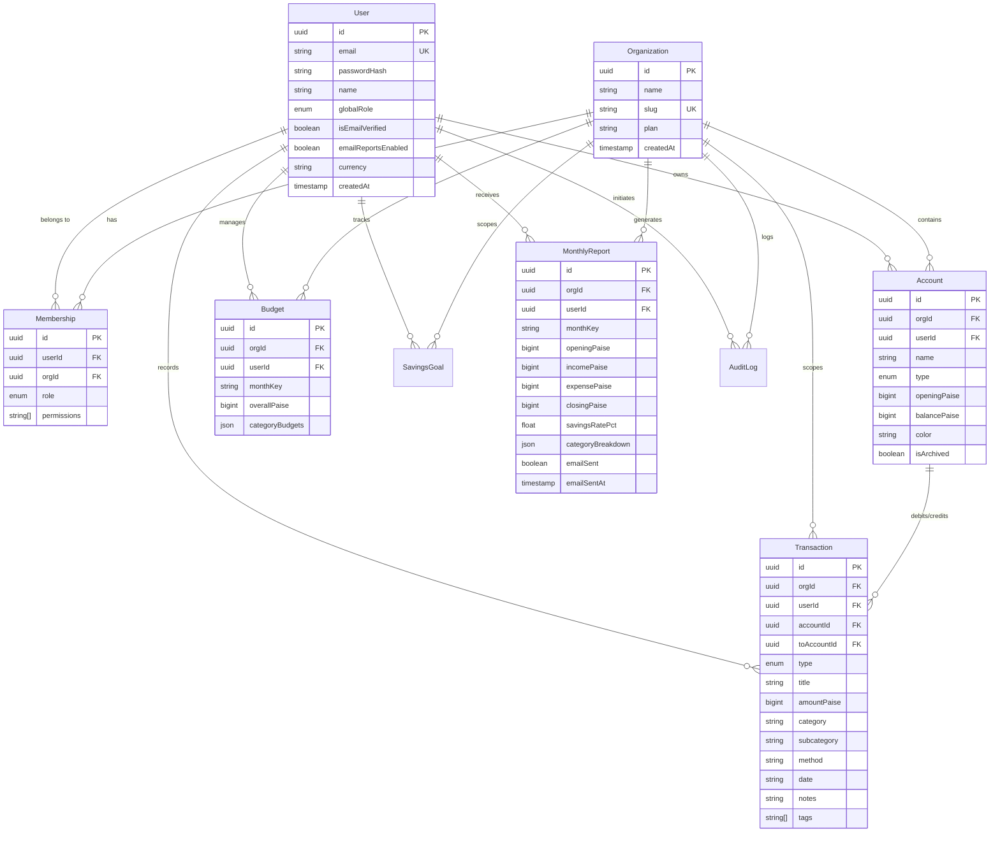

# Database Schema & Entity-Relationship Model

## 1. Relational Entity-Relationship Diagram

## 2. Table Specifications & Index Strategy

### `User` Table
- `id`: UUID (Primary Key, default uuidv4)
- `email`: VARCHAR(255), UNIQUE, INDEXED.
- `passwordHash`: VARCHAR(255) (Argon2id / bcrypt 12-round salt).
- `globalRole`: ENUM ('SUPER_ADMIN', 'ADMIN', 'USER').
- `isEmailVerified`: BOOLEAN.

### `Transaction` Table
- `id`: UUID (Primary Key).
- `orgId`: UUID (Foreign Key -> Organization, INDEXED).
- `userId`: UUID (Foreign Key -> User, INDEXED).
- `accountId`: UUID (Foreign Key -> Account).
- `amountPaise`: BIGINT NOT NULL (Exact currency stored in paise; e.g. ₹1,500.50 = `150050`).
- `date`: VARCHAR(10) (ISO Date `YYYY-MM-DD`, COMPOSITE INDEX on `[orgId, date]`).

### `MonthlyReport` Table
- Composite unique constraint on `[orgId, userId, monthKey]`.
- Enforces strict monthly immutability and idempotency preventing duplicate report generation.
