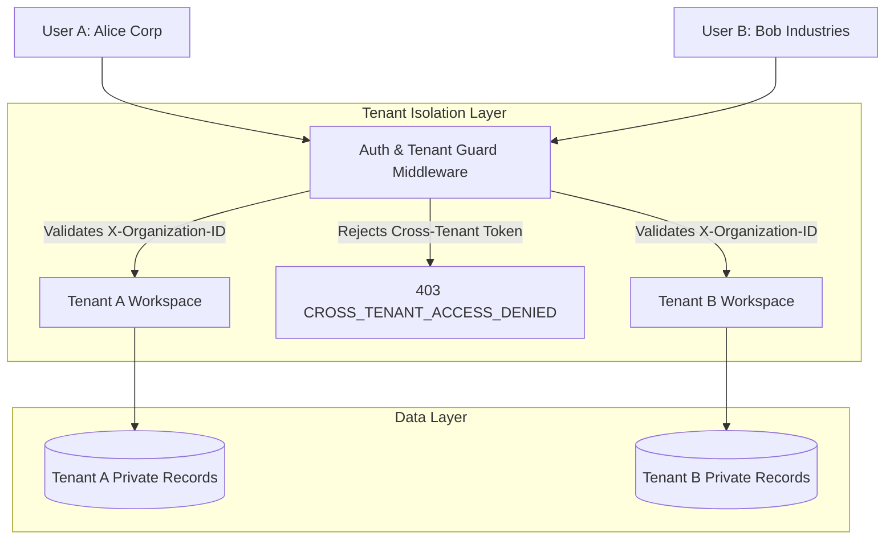

# System Architecture — LedgerFlow Enterprise Multi-Tenant SaaS

## 1. High-Level Architecture Overview

LedgerFlow is designed as a distributed, multi-tenant financial SaaS platform utilizing a **Three-Server Active Clustering Architecture** behind a high-availability reverse proxy and load balancer.

```
                                  [ Users & Clients ]
                                          │
                                          ▼
                      ┌───────────────────────────────────────┐
                      │    Nginx / Smart Reverse Proxy LB     │ (Port 4000)
                      │    - SSL/TLS Termination              │
                      │    - Rate Limiting (Token Bucket)     │
                      │    - Active Health Checks (Heartbeat) │
                      │    - Round-Robin / Least-Conn Routing │
                      └───────────────────┬───────────────────┘
                                          │
            ┌─────────────────────────────┼─────────────────────────────┐
            │                             │                             │
            ▼                             ▼                             ▼
┌───────────────────────┐     ┌───────────────────────┐     ┌───────────────────────┐
│ Application Server 1  │     │ Application Server 2  │     │ Application Server 3  │
│ Port: 4001            │     │ Port: 4002            │     │ Port: 4003            │
│ Node.js 20 / Express  │     │ Node.js 20 / Express  │     │ Node.js 20 / Express  │
│ TypeScript REST API   │     │ TypeScript REST API   │     │ TypeScript REST API   │
│ Instance: server-1    │     │ Instance: server-2    │     │ Instance: server-3    │
└───────────┬───────────┘     └───────────┬───────────┘     └───────────┬───────────┘
            │                             │                             │
            └─────────────────────────────┼─────────────────────────────┘
                                          │
                     ┌────────────────────┴────────────────────┐
                     │                                         │
                     ▼                                         ▼
        ┌─────────────────────────┐               ┌─────────────────────────┐
        │   PostgreSQL 16 Engine  │               │   Redis 7 Distributed   │
        │   - Prisma ORM Client   │               │   - Sliding Rate Limit  │
        │   - Row-Level Security  │               │   - Token Blacklist     │
        │   - UUID Primary Keys   │               │   - Cache Store         │
        │   - Integer-Paise Math  │               │   - Session Sync        │
        └─────────────────────────┘               └─────────────────────────┘
```

## 2. Multi-Tenant Logical Separation Model

Each tenant (User or Organization) operates within a cryptographically and logically isolated boundary.



## 3. Core Architectural Pillars

1. **Stateless Application Servers**:
   - Application instances (`app1`, `app2`, `app3`) store zero session state in local memory or filesystem.
   - Authentication relies on signed stateless JSON Web Tokens (JWT) paired with Redis-backed refresh tokens.
   - Any server can handle any request transparently.

2. **Zero-Balance New User Initialization**:
   - Genuine new accounts start with `Total Balance = ₹0`, `Total Income = ₹0`, `Total Expenses = ₹0`, and `Transaction Count = 0`.
   - Dedicated isolated workspace created with zero demo data leakage.

3. **Exact Decimal Minor-Unit Arithmetic (Paise)**:
   - Floating-point calculations (`0.1 + 0.2 = 0.30000000000000004`) cause severe auditing discrepancy in financial systems.
   - LedgerFlow converts all monetary values into 64-bit integer paise (`1 INR = 100 paise`), ensuring exact mathematical precision across balances, totals, and budget reports.

4. **Automated Monthly Reporting & Email Engine**:
   - Automatically computes opening balance from historical transactions prior to the target month.
   - Aggregates monthly inflows and outflows, calculates savings percentages, and provides a category-wise breakdown.
   - Dispatches a verified email notification with PDF report preview.
